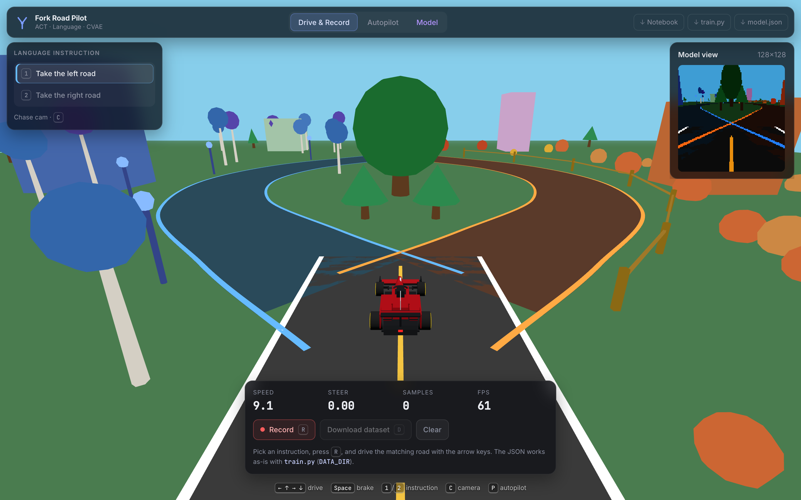
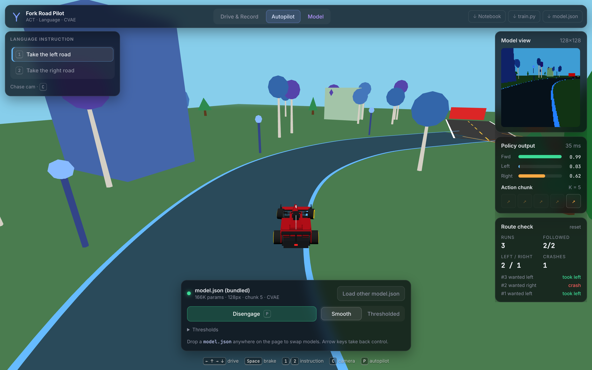
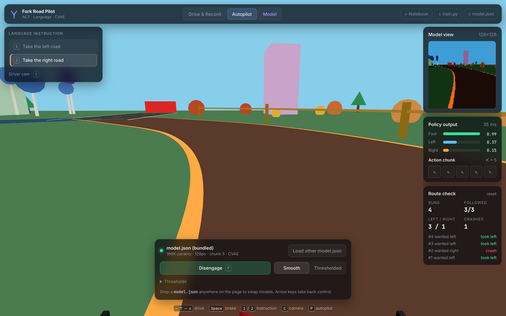
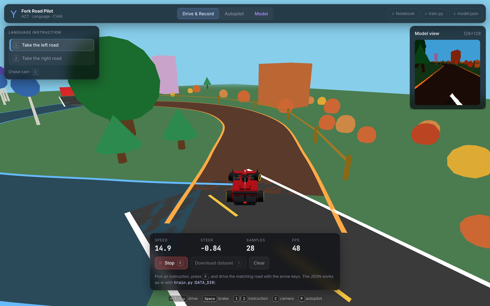
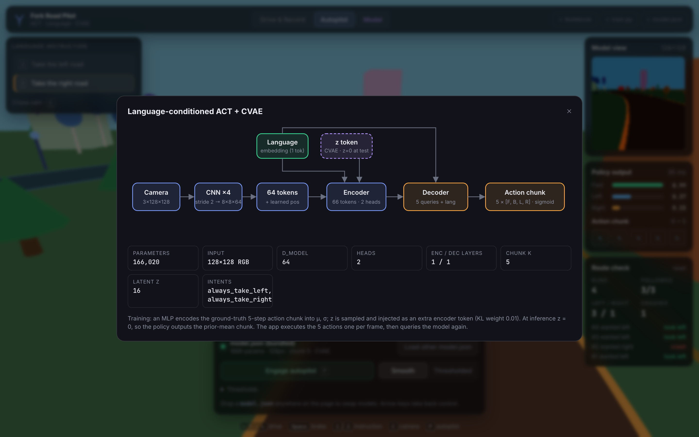
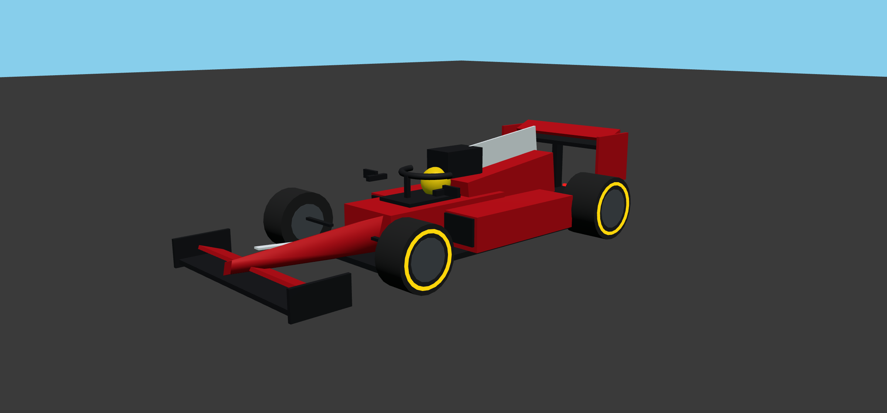

# Fork Road Pilot

**A language-conditioned driving policy (ACT + CVAE) that runs live in your browser.**
Tell the car *"take the left road"* or *"take the right road"*. A 166K-parameter vision transformer reads the 128×128 driver camera and drives a 3D fork-road course, five actions at a time.



- **Runs entirely in the browser.** The model runs in plain JavaScript with no ML runtime, so it needs no server or GPU backend. A forward pass takes about 30 ms.
- **The full loop in one page:** drive and record demonstrations, train in Colab, then drop the `model.json` back in and watch it drive.
- **Built-in route check** scores every autopilot run: did the car take the road it was told to?

---

## Contents

- [Features](#features)
- [Quick start](#quick-start)
- [How it works](#how-it-works)
- [Train your own model](#train-your-own-model)
- [Current results](#current-results)
- [Project layout](#project-layout)
- [Deploy](#deploy)
- [Gotchas](#gotchas)

---

## Features

### Autopilot

Load the bundled model (or drop your own `model.json` anywhere on the page) and press **P**. The side panel shows, live:

- **Model view:** the exact 128×128 frame the network sees.
- **Policy output:** the forward, left and right probabilities for the step being executed, plus how long the model call took.
- **Action chunk:** the 5 steps predicted per model call. The highlighted cell is the one being executed now.
- **Route check:** runs, how many times the car took the instructed road, the left/right split, crashes, and a per-run log.



Two control modes:

| Mode | Behaviour |
| --- | --- |
| **Smooth** (default) | Throttle on if `P(fwd) > 0.30`, steer by `P(left) − P(right)`. |
| **Thresholded** | Discrete left/right keys gated by the threshold sliders (fwd, left min, right min, turn margin). |

Arrow keys take control back from the autopilot at any time.

### Driver camera

Press **C** to switch between the chase cam and the driver cam. Here the instruction is *take the right road* and the car is on the right branch.



### Drive & record

Pick an instruction, press **R**, and drive the matching road with the arrow keys. Every steering frame is kept. Only every 10th straight-ahead frame is kept, so the dataset isn't dominated by straight driving. **D** downloads a JSON file that `train.py` reads as-is.



### Model inspector

The **Model** tab shows the architecture and the hyperparameters read from whichever `model.json` is loaded.



### The car

An open-wheel F1-style car with a nose and front wing, sidepods, halo, airbox and DRS rear wing. It's purely cosmetic: it is hidden while the policy's camera frame is rendered (see [Gotchas](#gotchas)).



### Controls

| Key | Action |
| --- | --- |
| `↑` `↓` `←` `→` | Drive (also takes over from the autopilot) |
| `Space` | Brake |
| `1` / `2` | Instruction: take left / take right |
| `C` | Chase cam ↔ driver cam |
| `R` | Start / stop recording (Drive mode) |
| `D` | Download recorded dataset |
| `P` | Engage / disengage the autopilot |

---

## Quick start

There's no build step. The app is static HTML and ES modules, with Three.js loaded from a CDN.

```bash
python3 -m http.server 5174 --directory app
```

Open <http://localhost:5174>, click **Autopilot**, and press **P**.

> Opening `app/index.html` straight from disk won't work: browsers block ES-module imports and `fetch('model.json')` over `file://`. Use any static server.

---

## How it works

```
camera 3×128×128
   └─ CNN: 4 × (3×3 conv, stride 2, ReLU)  →  8×8×64
        └─ 64 spatial tokens (+ learned position)
                                   ┌── language token  (embedding of intent id)
                                   ├── z token         (CVAE latent; z = 0 at inference)
   Transformer encoder (66 tokens, d=64, 2 heads, 1 layer)
        └─ memory
   Transformer decoder: 5 action queries + language token  (1 layer)
        └─ action head → 5 × [forward, backward, left, right]  (sigmoid)
```

- **Action chunking (ACT):** one forward pass predicts the next 5 actions. The app executes them one per frame, then queries the model again.
- **CVAE:** during training, an MLP encodes the ground-truth action chunk into μ, σ. The sampled *z* goes into the encoder as an extra token, with KL weight 0.01. At inference *z* = 0, the prior mean.
- **Language conditioning:** the intent embedding is both an encoder token and added to every decoder query, so the same image can produce different actions for "left" vs "right".
- **Training:** 100 epochs of SGD with warm-up and decay, then 100 epochs of Adam with cosine decay. The loss is BCE on the action chunk plus the KL term. Training applies brightness, contrast, noise and color-jitter augmentation.

`app/js/policy.js` is a dependency-free re-implementation of the PyTorch forward pass. It reads the `model.json` exported by `train.py` and mirrors PyTorch's `TransformerEncoderLayer` and `TransformerDecoderLayer` (post-norm, ReLU, eps 1e-5). Its logits match a reference implementation to within **5e-7**.

---

## Train your own model

1. **Collect data.** In **Drive & Record**, record a few laps per instruction, then download each JSON. Drive the instructed branch *and* through the merge to the red finish board.
2. **Train.** Open `train.ipynb` in Colab (or run `train.py`) with your JSON files in `data/`:
   ```bash
   DATA_DIR=data python train.py
   ```
   It prints per-intent probabilities and a cross-intent sanity check, then writes `model.json`.
3. **Test.** Drag `model.json` onto the app (or replace `app/model.json`), switch to **Autopilot**, and watch the route check.

---

## Current results

Bundled model (`artifacts/model.json`), smooth control, starting at the fork, fixed 60 Hz steps:

| Instruction | Branch taken | Outcome |
| --- | --- | --- |
| Take the left road | left ✅ | Finishes the course in ~7 s |
| Take the right road | right ✅ | Crashes into the building at about (25.6, −56) after the merge |

The policy always picks the instructed branch. On the right branch it doesn't straighten up after the merge. The reference implementation shows the same behaviour, so the cause is the model, not the app. More right-branch demonstrations driven through the merge should fix it.

---

## Project layout

```
.
├── app/                      # the web app (deploy this folder)
│   ├── index.html
│   ├── style.css
│   ├── model.json            # bundled policy (copy of artifacts/model.json)
│   ├── train.py, train.ipynb # served as downloads
│   └── js/
│       ├── main.js           # UI, main loop, autopilot, route check
│       ├── world.js          # fork-road scene (must match training data)
│       ├── car.js            # physics, cameras, F1 body
│       ├── camera-feed.js    # driver-cam render target → tensor / JPEG / preview
│       ├── recorder.js       # dataset recording in train.py's format
│       └── policy.js         # pure-JS ACT + CVAE forward pass
├── artifacts/model.json      # trained weights exported by train.py
├── train.py / train.ipynb    # training script / Colab notebook
├── scripts/screenshots.mjs   # regenerates the README screenshots
└── docs/screenshots/
```

---

## Deploy

`app/` is a static site:

```bash
vercel deploy app
```

Netlify, GitHub Pages, or any static host works the same way.

---

## Gotchas

- **Don't restyle the world without retraining.** The CNN only works on frames that look like its training data. `world.js` (layout, colors, seeded scenery) and the driver camera and physics in `car.js` intentionally match the setup the data was recorded with. The UI, the car body and the chase cam are safe to change.
- **The car is hidden from the policy camera.** The original training car never appeared in the 128×128 frame. The F1 body's nose would, so `CameraFeed.hidden` leaves it out of the policy's render, and the frames stay pixel-identical to before.
- **The driver cam uses the window's aspect ratio.** It renders into a square target with the window's aspect, just like the recorder did, so very tall or very wide windows squeeze the frame differently.
- **Slow frames freeze physics.** Frames longer than 100 ms are skipped, as in the original sim. On a throttled tab the car won't move.
- **`?debug` adds a fixed-timestep driver** (`fork.pause()`, `fork.run(n)`, `fork.engage()`, …) for tests and screenshots on slow machines.
- **Screenshots need a GPU.** `scripts/screenshots.mjs` runs headless Chrome on the Metal GPU. With the SwiftShader software renderer, frames differ slightly and the policy drives off course.

### Regenerating the screenshots

```bash
python3 -m http.server 5174 --directory app   # in one terminal
node scripts/screenshots.mjs                    # writes docs/screenshots/*.png
```
